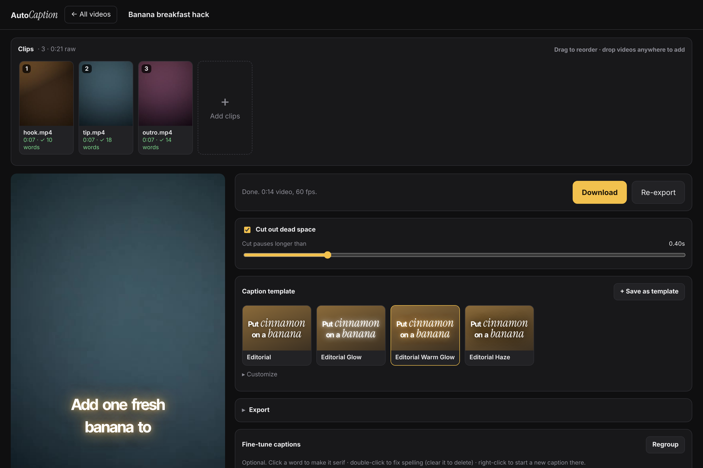
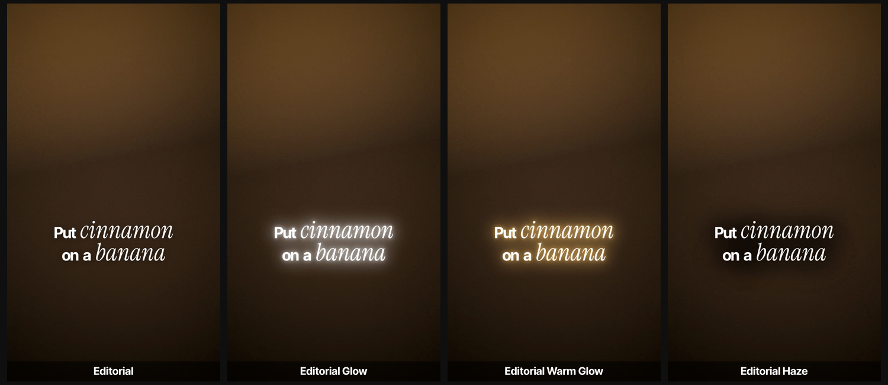
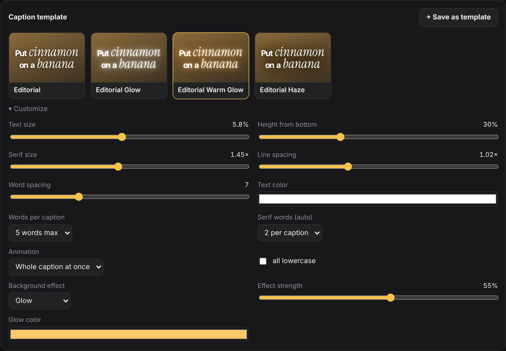
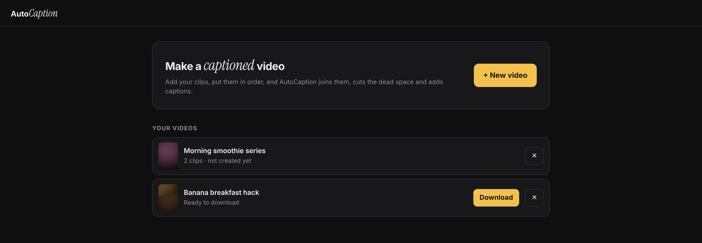

# AutoCaption

Local, free caption studio for short-form video. Drop in your clips, drag them into order, and AutoCaption joins them, trims the dead space, burns in animated captions, and exports a 60 fps MP4. Everything runs on your own computer: no subscription, no uploads, no usage limits.

<p align="center"></p>



## Features

- **Multi-clip timeline**: add clips, drag to reorder, remove, retry. Each clip is transcribed in the background as soon as it is added.
- **Automatic dead-space cutting**: pauses longer than a threshold you set (0.40 s by default) are trimmed out, and captions follow the cuts.
- **Word-level transcription**: [faster-whisper](https://github.com/SYSTRAN/faster-whisper) runs locally. It uses an NVIDIA GPU when one is available and falls back to the CPU when it is not.
- **Caption templates**: an editorial look with a bold tight sans plus key words in a large italic serif, in four variants. You can save your own.
- **Background effects**: soft shadow, glow (any colour) or dark haze, with adjustable strength.
- **Live preview** that matches the exported video, plus a caption editor:
  - click a word to toggle serif;
  - double-click to fix spelling;
  - right-click to split a caption;
  - merge captions with the next one.
- **High-quality export**: H.264 at 60 fps (or 30 fps) with CRF 15 and 256 kbps AAC audio. Mixed vertical and horizontal clips are cropped to fill the dominant orientation.

## Templates



| | |
|---|---|
|  |  |

## Getting started (Windows)

1. Install [Python 3.10+](https://python.org) and ffmpeg (`winget install ffmpeg`). The launcher tries to install either one with winget if it is missing.
2. Double-click **`Start AutoCaption.bat`**. On the first run it creates a `.venv` and installs the requirements.
3. Your browser opens to <http://127.0.0.1:5055>. Leave the console window open; closing it quits the app.

**`Open AutoCaption.bat`** opens the app if it is already running and starts it if it is not. Point a shortcut at it (using `AutoCaption.ico`) and pin it to the taskbar.

The first transcription downloads the Whisper `small` model (~500 MB, one time only).

**macOS / Linux:** `brew install ffmpeg` (or your package manager), then run `Start AutoCaption.command` or:

```bash
python3 -m venv .venv && .venv/bin/pip install -r requirements.txt
.venv/bin/python app.py
```

## How it works

| Step | What happens |
|---|---|
| Upload | Clip saved under `videos/<project>/`, probed with ffprobe, thumbnail generated |
| Transcribe | Audio decoded with ffmpeg into 16 kHz mono, then faster-whisper with word timestamps and VAD |
| Create | Keep-ranges computed per clip from the word timings; captions grouped (max N words, split on pauses and sentence ends) and serif words picked; low-res preview rendered |
| Export | One ffmpeg filtergraph with `trim`/`atrim` per kept range, scale/crop to target, `fps=60`, `concat`, then the `ass` filter burns the captions using the bundled fonts |

Captions are written as ASS subtitles: one event per line, positioned by hand for tight leading, plus effect layers (blurred shadow, glow or haze) underneath. The browser preview mirrors the same layout maths in CSS.

## Project layout

```
app.py              Flask server: projects, clips, transcription queue, render pipeline
autocaption.py      Caption engine (chunking, serif picking, ASS builder) + standalone CLI
index.html          The whole UI (vanilla JS, no build step)
fonts/              Inter Tight Bold, Instrument Serif Italic, Poppins Bold (SIL OFL)
docs/               Screenshots for this README
videos/             Your projects (git-ignored)
my_templates.json   Your saved templates (git-ignored)
```

### CLI

`autocaption.py` also works on its own for batch captioning:

```bash
python autocaption.py my_clips/                  # caption every video in a folder
python autocaption.py video.mp4 --emphasize cinnamon,banana
python autocaption.py video.mp4 --style bold     # older yellow-highlight look
```

## Adding a template

Built-in templates live in `BUILTIN_TEMPLATES` in `app.py`. A template is a name plus a set of style settings:

```python
dict(id="editorial-glow", name="Editorial Glow", builtin=True,
     settings=dict(_EDITORIAL, effect="glow", effect_color="#FFFFFF", effect_strength=0.5))
```

To use a new font, drop the `.ttf` into `fonts/` and add a matching `@font-face` rule in `index.html` so the preview can use it too.

## License

Copyright © 2026 Hadi Usmani. All rights reserved.

This code is shared for viewing and portfolio purposes only. You may not copy, modify, distribute or use it without written permission. See [LICENSE](LICENSE).

The bundled fonts (Inter Tight, Instrument Serif and Poppins) are third-party works under the SIL Open Font License. Their licence texts are in `fonts/`.
